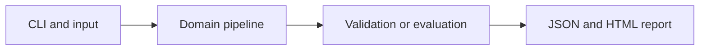

# Denoising Autoencoder

Train an encoder-decoder neural network to reconstruct clean signals from noisy observations.

**Category:** Deep Learning

**Execution:** Actual local algorithm or workflow; no external model service required.

## Run

```sh
python -m venv .venv
# Windows: .venv\Scripts\activate
# macOS/Linux: source .venv/bin/activate
python -m pip install -r requirements.txt
python app.py
python -m unittest discover -v
```

Open `results/report.html` after running. Python 3.10+ is required. Use `--help` for input and seed options.

## Architecture



## Algorithm

A 16-dimensional input passes through a five-unit tanh bottleneck and linear decoder. Backpropagate mean squared reconstruction loss to both layers. Fresh Gaussian corruption is sampled each epoch.

## Evaluation

Train and test on independent sinusoidal signals. Compare reconstruction MSE with noisy-input MSE. Store clean, noisy and reconstructed examples for inspection.

## Limitations

The data lies on a simple low-dimensional manifold; this is signal denoising, not a diffusion image generator.

## Documentation

- [PDF project guide](PROJECT_GUIDE.pdf)
- [Editable guide](GUIDE.md)
- [Model and system card](MODEL_CARD.md)
- [Measured results](results/metrics.json)
- [Test output](TEST_RESULTS.txt)

## Extend it

Add held-out frequencies, realistic noise, validation-based early stopping and reconstruction plots. Compare a linear PCA denoiser.

AI-assisted educational project with synthetic data. Review, customize and explain your own contribution accurately. MIT license.
